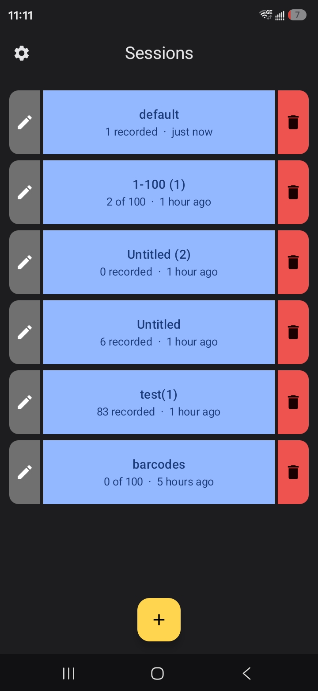
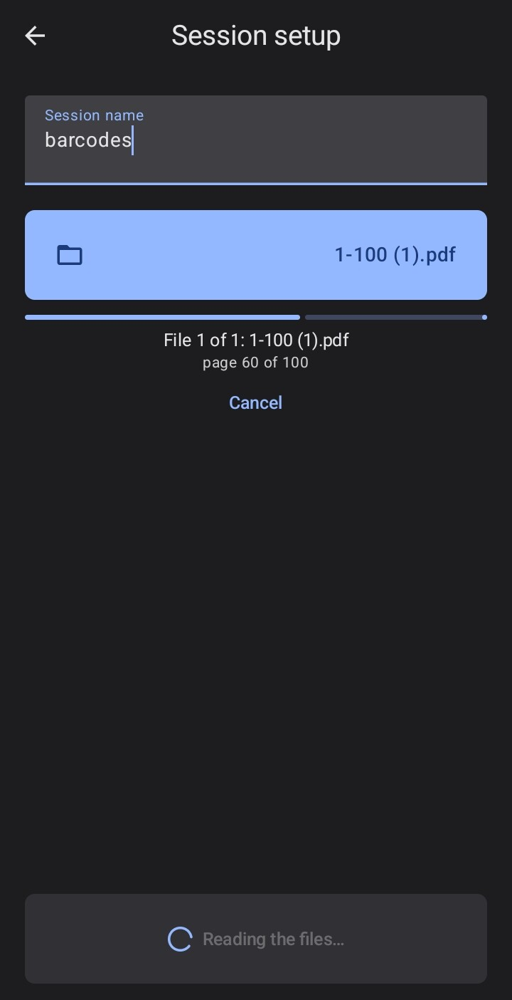
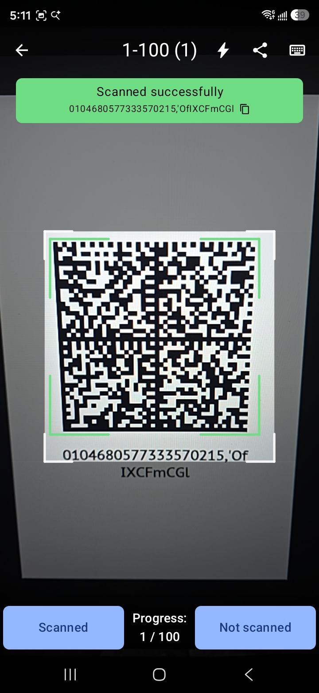
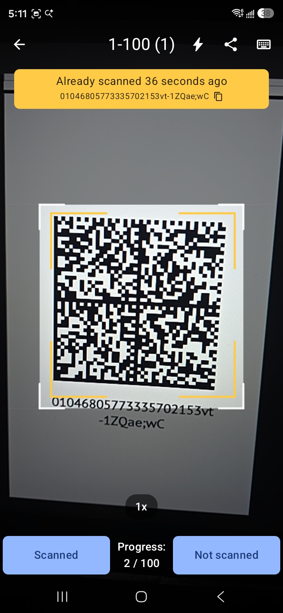
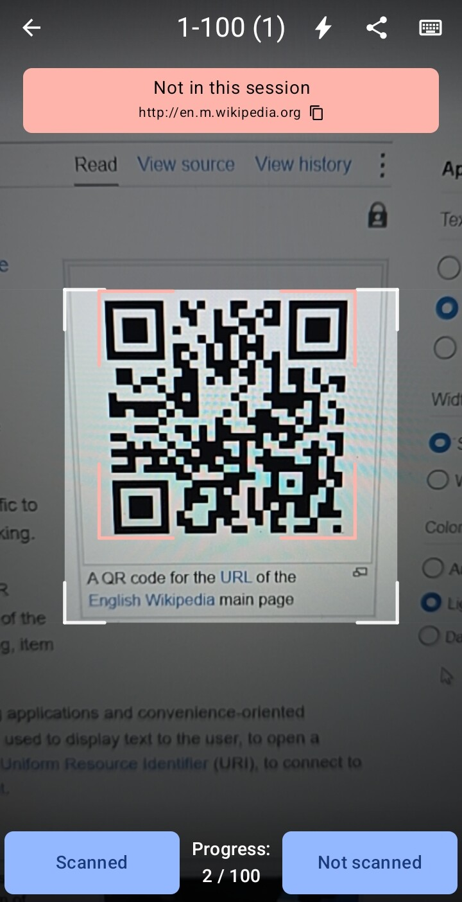
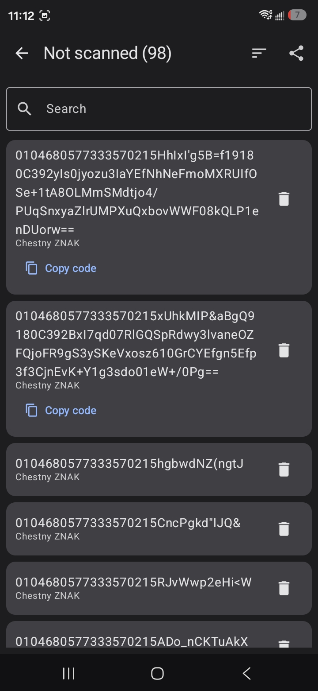

# QR Checker
[](https://github.com/LeonovAndreww/QR-Checker/actions/workflows/ci.yml)
[](https://github.com/LeonovAndreww/QR-Checker/releases)
[](https://www.android.com/)
[](https://github.com/LeonovAndreww/QR-Checker/stargazers)
[](LICENSE)

Android application for checking a shipment against a list of codes: load the list from a
document, then scan the boxes with the camera and see what is already done and what is
still missing.

## Screenshots

<p align="center">
  
  
  
</p>
<p align="center">
  
  
  
</p>

## What it does

A session is a list of codes and the marks on it. The list is read out of a document -
PDF, photos, screenshots, text or CSV, several files at once. Then you scan the boxes, and
for every code the app answers: scanned, already scanned and how long ago, or not in this
session at all. A torn label can be typed in by hand - any part of the code is enough to
find it.

Data Matrix, QR and linear barcodes are all read. A retail label usually carries a product
barcode next to the Data Matrix, so the symbology of every code is kept and the unneeded
kind can be unticked before the session is created.

The scanned and remaining lists are searchable and sortable; a code is copied with a swipe
right and moved to the bin with a swipe left, where it waits a week. A list exports to CSV,
and a whole session can be sent as a file - the other phone merges the marks into the
session it already has. Sessions are also backed up to a folder of your choice and survive
uninstalling the app.

A session can also start without a document: it then collects every new code it sees and
only catches repeats. Adding a document later turns it into a checking session.

### Supported codes

| Kind | What is read |
| --- | --- |
| GS1 element strings | GTIN, serial, batch, expiry and the rest, in any field order, with or without separators |
| Chestny ZNAK (Russia) | GS1 with the (91)/(92) or (93) crypto tail; the list shows the (01)(21) part printed on the box |
| EU FMD, İTS, SNCM | Medicine packs: GTIN, serial, batch and expiry |
| GS1 Digital Link | `https://…/01/<gtin>/10/<batch>?17=<expiry>`, checked by the GTIN check digit |
| IFA PPN (Germany) | ISO/IEC 15434 envelope with ASC MH10 identifiers |
| HIBC LIC | Primary and secondary data per ANSI/HIBC 2.6, mod 43 check character |
| EAN / UPC | By length and check digit |
| Anything else | QR with a link or text is matched as is |

## Architecture

A single-activity Compose app with one view model per screen.

```
ui/<feature>/   Screen (stateless rendering) + ViewModel (StateFlow<UiState>, one-off events)
data/           SessionRepository over Room (DAO, entities), SessionBackup to a user folder
codes/          What a code is and what it carries: GS1, HIBC, PPN, Digital Link, CSV lists
files/          Reading PDFs, images and lists; session files; CSV export
scan/           Scan decisions: verdict, presence of codes in view, linear read vote, smoothing
settings/       App settings, in-app language switching
di/             Hilt module: database, DAO, application scope
```

- Dependencies are injected with Hilt; view models get the repository and read navigation
  arguments from `SavedStateHandle`.
- The parsing and scan decision code is plain Kotlin with no Android types, so it is
  covered by fast JVM tests. The Room layer and the scan view model are tested against an
  in-memory database under Robolectric.
- Camera frames are decoded by ML Kit on a background executor; the screen receives every
  code in the frame and `CodePresence` decides whether to answer, so a code held in view is
  answered once, even with several codes in the viewfinder.
- Marks are written on an application-wide scope: leaving the screen right after a scan
  does not lose the write, and a failed write takes the shown answer back.

## Technologies used
[](https://kotlinlang.org/) 
[](https://developer.android.com/jetpack/compose)
[](https://m3.material.io/)
[](https://developer.android.com/training/data-storage/room)
[](https://developer.android.com/training/camerax)
[](https://developers.google.com/ml-kit/vision/barcode-scanning)
[](https://dagger.dev/hilt/)

The barcode model is bundled into the package, so the app does not need Google Play
services to be installed.

## Permissions

- **Camera** - required to scan codes in real time.
- **Vibrate** - provides haptic feedback for each scan result.

The app asks for nothing else. Internet access is explicitly removed from the manifest.

## Privacy

- The app works fully locally - sessions, codes and marks stay on the device and are
  **not** sent to any server.
- What is stored:
  - Sessions: the code lists, which of them are scanned and when.
  - App settings, and the folder picked for backups.
  - Temporary files while a document is being read, and the CSV files you export.
- The session database is left out of Android cloud backup - use the app's own backup to
  a folder instead.
- How to delete data:
  - Delete a session in the app, or empty the bin on its edit screen.
  - Uninstalling the app deletes all of its local data. Files written to your backup
    folder and exported CSVs stay where they are.
- Third-party telemetry:
  - There is no analytics/telemetry enabled.

The full policy is published at
[leonovandreww.github.io/QR-Checker/privacy.html](https://leonovandreww.github.io/QR-Checker/privacy.html).

## Installation
### Option A - Download APK
1. Go to [Releases](https://github.com/LeonovAndreww/QR-Checker/releases).
2. Download the latest 'qr-checker.apk' on your device.
3. Enable "Install from unknown sources" if needed.
4. Install the application.

### Option B - Build from source
```bash
git clone https://github.com/LeonovAndreww/QR-Checker.git
cd QR-Checker
./gradlew assembleDebug

./gradlew installDebug
```
Run the same checks as CI:
```bash
./gradlew assembleDebug testDebugUnitTest lintDebug
```

Alternatively, open the project in [Android Studio](https://developer.android.com) and run on an emulator or device.

Release builds are signed from `keystore.properties` next to the project - copy
`keystore.properties.example` and fill it in. Without that file `assembleRelease` still
works and simply leaves the APK unsigned, so a fresh clone builds.

Requires Android 7.0 (API 24) or newer.

## License

Licensed under the [Apache License 2.0](LICENSE). You may use, modify and
redistribute the code, including commercially, as long as the copyright notice and the
license are kept and changed files are marked as changed.

## Contact
Issues and feature requests are tracked via GitHub Issues:
- [Create new issue](https://github.com/LeonovAndreww/QR-Checker/issues)
